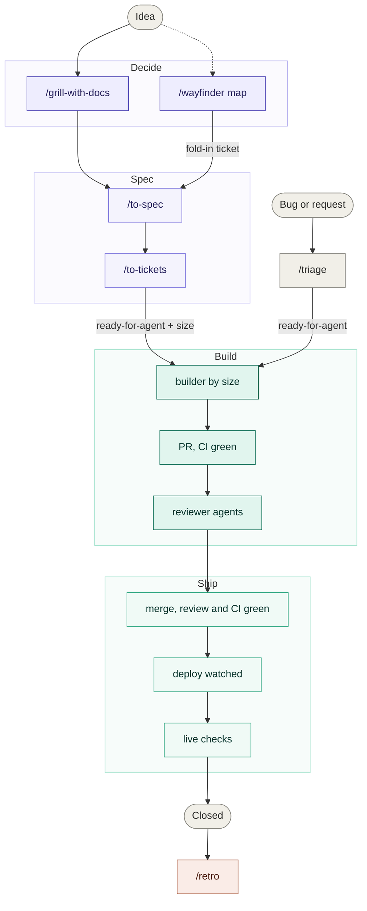
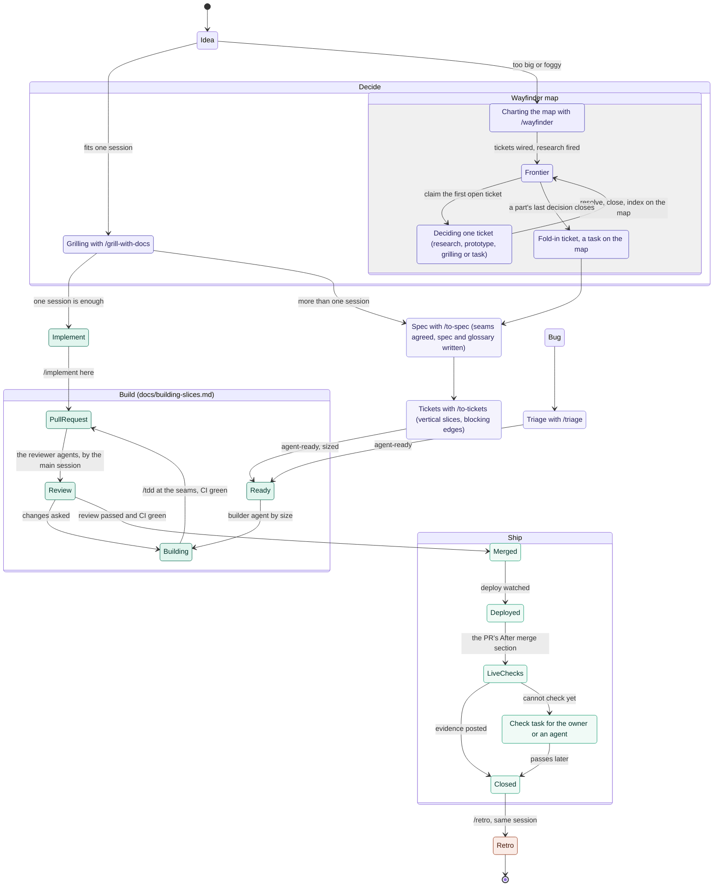

# slice-flow

My way of shipping with agents, on top of [Matt Pocock's engineering skills](https://github.com/mattpocock/skills). His skills take an idea to a spec and tickets (`/grill-with-docs`, `/wayfinder`, `/to-spec`, `/to-tickets`) and review the result (`/code-review`). The slice flow is what happens between: a **slice** (a `ready-for-agent` ticket with a size label) goes to a **builder** agent picked by size, up to an open PR with CI green; the **main session** reviews and merges it, and the slice closes only once it is live and checked.

Two skills, one set of agents, three repo templates:

| Piece | What it is |
|---|---|
| [`SKILL.md`](SKILL.md) | `/slice-flow`: the main session's steps from a ready ticket to a closed one, the size table, check tasks. Model-invoked: "build #42" reaches it. |
| [`agents/`](agents) | Five builder agents, one per size and one for escalations. Generic: no project name inside. |
| [`templates/building-slices.md`](templates/building-slices.md) | The builder's steps, the prototype rules and the PR body; one *Repo-specific* section for what the repo must say itself. |
| [`templates/issue-tracker-addendum.md`](templates/issue-tracker-addendum.md) | What gets appended to Matt's `docs/agents/issue-tracker.md`: the labels, abandoned claims, the fold-in ticket, prototype resolutions. |
| [`templates/workflow.md`](templates/workflow.md) | The two diagrams below, as `docs/agents/workflow.md` in the repo. |
| [`../setup-slice-flow`](../setup-slice-flow) | `/setup-slice-flow`: wires a repo in one run. |

## The route

Decisions happen on the left and produce decisions, never code. Code happens on the right, one ticket per session. The only way from one side to the other is a spec. `/retro` after shipping changes the environment the next decide starts from: these docs, the checks, the standards the reviewer agents enforce.

## The full map

Mermaid can't show colons, so the labels read: the map is `wayfinder:map`, the fold-in is a `wayfinder:task`, agent-ready is `ready-for-agent`, sizes are `size:xs` to `size:l` plus `escalate`, check tasks are `check:owner` or `check:agent`.

## What it adds to Matt's flow

| Gap in the default flow | What the slice flow does |
|---|---|
| Implementer agents inherit the parent model. | A size label routes each ticket to its builder agent; every agent runs on one model pair from the cost-vs-intelligence frontier (below): GPT first, Claude as fallback. Never Sonnet or Fable. |
| `/implement` reviews its own work in the same context. | The builder stops at an open PR. The main session reviews with `/code-review` and merges once the review passes and CI is green; the owner is asked only on a product decision not yet made, or an `escalate` slice. |
| Nothing happens after code review. | A slice closes only after the deploy and the live checks an agent can run now. What can't be checked yet becomes a `check:owner` or `check:agent` task, so no slice and no session waits. |
| A wayfinder map hands off by convention, and an empty frontier reads as done. | The fold-in is a `wayfinder:task` on the map, created when the last decision it needs closes. An assigned ticket with no comment from its assignee is abandoned, not claimed. |
| `/prototype` folds the decision into code, and the builder reads prose. | A slice built from a prototype names branch, commit, variant and file as an acceptance criterion, the builder reads that code first, and the PR shows the two side by side. The resolution lists the intended differences. |
| `/pr` has no view past merge. | The PR body gains an **After merge** section: what the deploy applies and which checks to run, marked agent now, agent later or owner. It is the only place a slice's live checks are written; check tasks are made from it verbatim. |

## Sizes and models

| Label | Amount of work | Agent |
|---|---|---|
| `size:xs` | Text, docs or config only | the main session |
| `size:s` | A vertical slice so small that one layer changes | `slice-builder-s` |
| `size:m` | One vertical slice across layers; any migration or infrastructure | `slice-builder-m` |
| `size:l` | Several slices' worth in one issue | `slice-builder-l` |
| `escalate` (wins) | A costly mistake, or a rebuild after a failed review | `slice-builder-escalated` |

Every agent, builders and reviewers alike, runs on one pair for now (the owner, 2026-10-21):

| | Model · effort | Intelligence | Cost a task | Time a task |
|---|---|---|---|---|
| First choice | GPT-6.1 Sol · xhigh, through `scripts/codex-agent.sh` | 51.0 | $0.39 | 5.0 min |
| Fallback | Claude Opus 5.5 · medium, the agent files | 51.2 | $1.34 | 3.4 min |

From the cost-vs-intelligence Pareto frontier on [slopalytics.com](https://slopalytics.com/) (Artificial Analysis data, re-read 2026-10-21, max and no-reasoning settings hidden). Across GPT and Claude the frontier runs GPT-6 Luna, Haiku 5.5 low to xhigh, GPT-6.1 Sol low to xhigh, then Opus 5.5 medium, high and xhigh. GPT-6.1 Sol xhigh matches Opus medium's intelligence at under a third of the cost; Opus medium is the nearest Claude setting, so a fallback costs no intelligence. No Sonnet, Fable, GPT-6 Astra, Gemini or Grok setting sits on the frontier.

Per-size pairs, for when the owner splits them again: s on GPT-6.1 Sol low (42.1, $0.13) with Haiku xhigh (41.2, $0.12) as fallback; l on Opus high (53.6, $1.82) with GPT-6.1 Sol xhigh; escalate on Opus xhigh (56.0, $3.46) with GPT-6 Astra xhigh (52.4, $2.31). Re-check the chart when new models ship, and update SKILL.md, this table, the agents and the script's defaults together.

The script runs `codex exec` with the agent file's body and the brief as the prompt. A builder gets a fresh worktree and a sandbox that writes only there and in the repo's git dir, with network on for `git push` and `gh`; a reviewer runs read-only. It exits 75 when GPT is unavailable (no CLI, a usage limit, a refused model), so the main session starts the Claude agent instead. A usage limit is remembered until the reset time Codex names (`~/.cache/slice-flow/gpt-unavailable-until`): until then the script exits 75 before making a worktree.

## Install

1. Matt's skills, then this repo's two skills into `~/.claude/skills/` (the root README has the one-liner).
2. In each repo: `/setup-matt-pocock-skills`, then `/setup-slice-flow`. The second one copies the agents, writes `docs/building-slices.md` with only its *Repo-specific* section asked about, appends to the tracker doc, writes `docs/agents/workflow.md`, creates the labels and points `CLAUDE.md` at it all.

Sessions started outside a repo don't load its `.claude/agents/`: install the agents at user scope (`ln -s ~/.claude/skills/slice-flow/agents/slice-*.md ~/.claude/agents/`), or the skill falls back to a general-purpose agent on Opus medium with worktree isolation. The GPT path needs the Codex CLI signed in (`codex login`); the script also finds the copy inside the ChatGPT app.

## Example prompts

- "Build #42." / "Pick up the next two slices."
- "What's ready to build?"
- "Size this ticket." / "Should this one be escalated?"
- "#42 is merged and deployed, close it."
- "Add the slice flow to this repo." (runs `/setup-slice-flow`)
