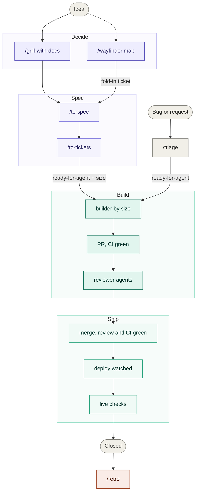
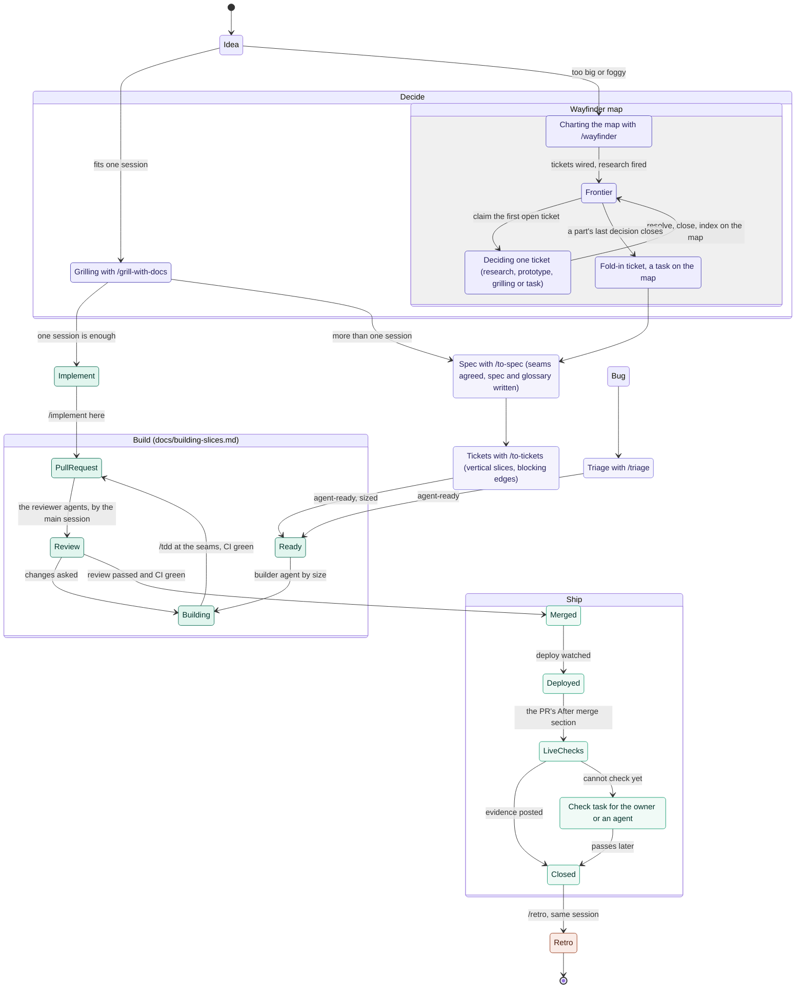

# How work moves: from idea to live

The reference for every session. Each state names the skill, document or
label behind it. Decisions happen on the left, code on the right, and nothing
crosses from one to the other except through a spec.

## The route

## The full map

## Reading the map

- **Decide** produces decisions, never code. A map is done when no sub-issue
  is open, the fold-in included, and *Not yet specified* is empty. An empty
  frontier alone is not done; see [issue-tracker.md](issue-tracker.md) for
  abandoned claims and the fold-in.
- **Spec** is the only way from decisions to work. `/to-spec` synthesises the
  conversation or the map's decisions, agrees the test seams, and writes the
  spec and glossary. `/to-tickets` cuts it into vertical slices, each
  `ready-for-agent` with a size from the table in the `slice-flow` skill.
- **Build** is one ticket per builder session, in its own worktree, up to an
  open PR with CI green. The main session reviews and merges once the review
  passes and CI is green; the owner is asked only on a product decision the
  owner has not made, or an `escalate` slice. A slice
  built from a prototype is checked against the prototype's code, not its
  prose ([building-slices.md](../building-slices.md)).
- **Ship** closes the ticket only after the deploy and the live checks an
  agent can run now. What cannot be checked yet becomes a check task outside
  the ticket.
- **Labels** (Mermaid can't show colons): the map is `wayfinder:map`, the
  fold-in is a `wayfinder:task`, agent-ready is `ready-for-agent`, sizes are
  `size:xs` to `size:l` plus `escalate`, check tasks are `check:owner` or
  `check:agent`.
- **Retro** runs in the session that built, before it is cleared, and
  changes the environment: these docs, the checks, the standards
  the reviewer agents enforce.

## On-ramps

- A bug or request you did not write: **Bug → Triage**. Tickets `/to-tickets`
  wrote are agent-ready already and never go through triage.
- A small fix you report yourself while testing live: straight to **Ready**
  as a sized ticket.
- A product question that comes up while building: a `wayfinder:grilling`
  ticket on the relevant map, never answered inside the slice.
